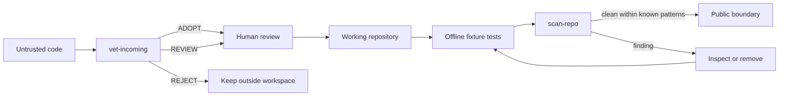
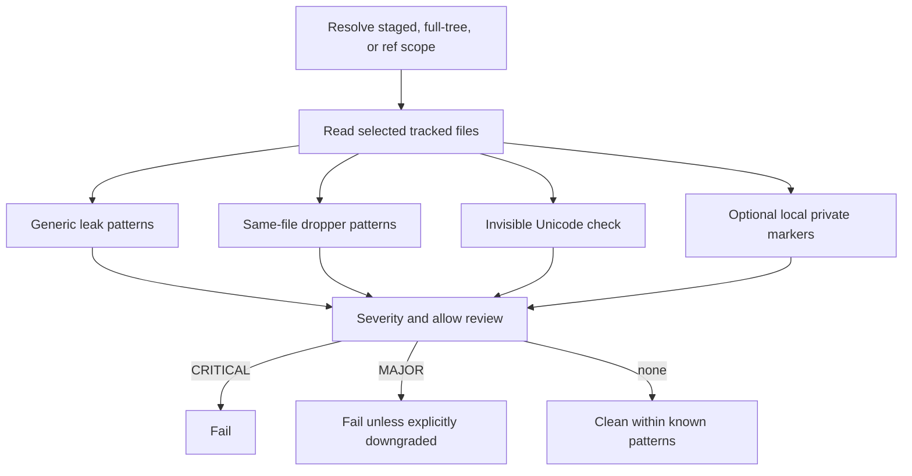
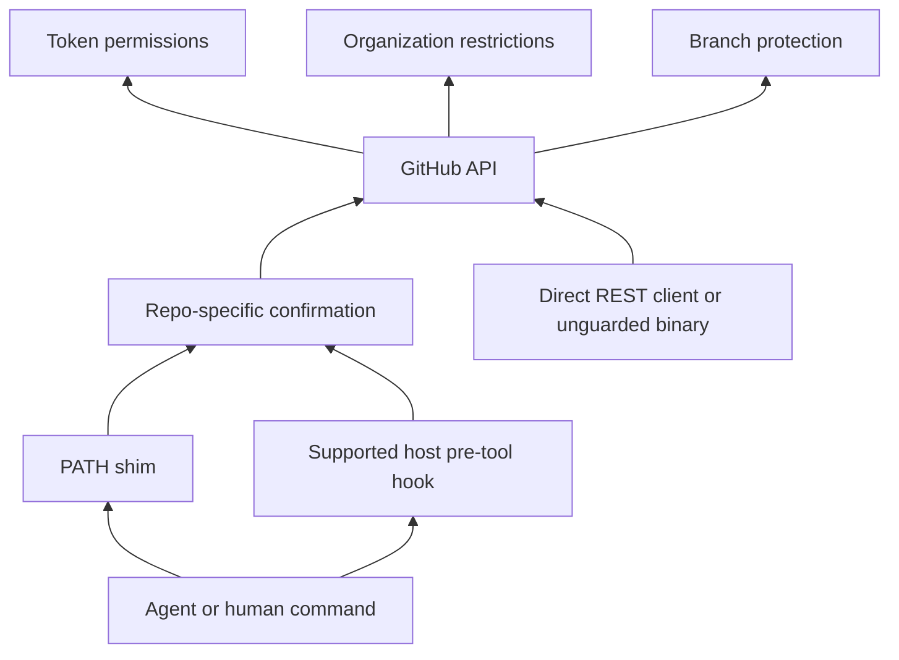
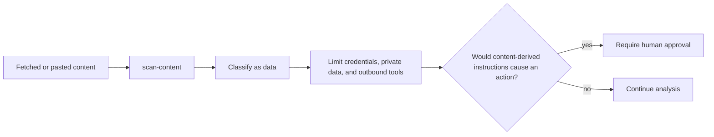
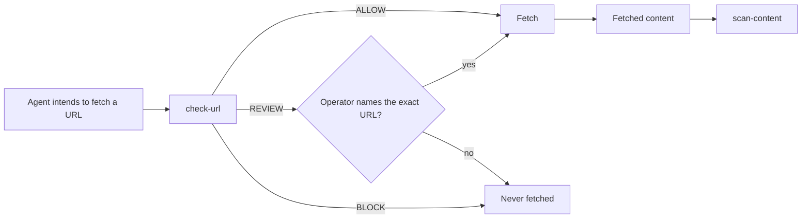
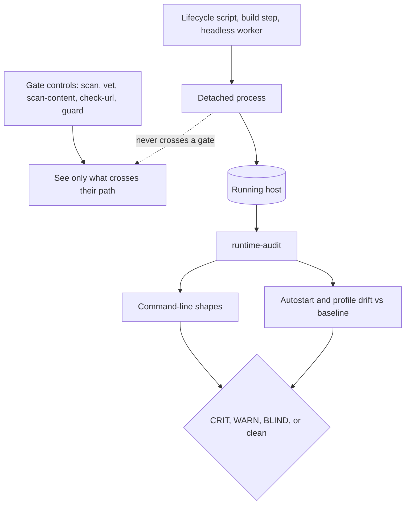
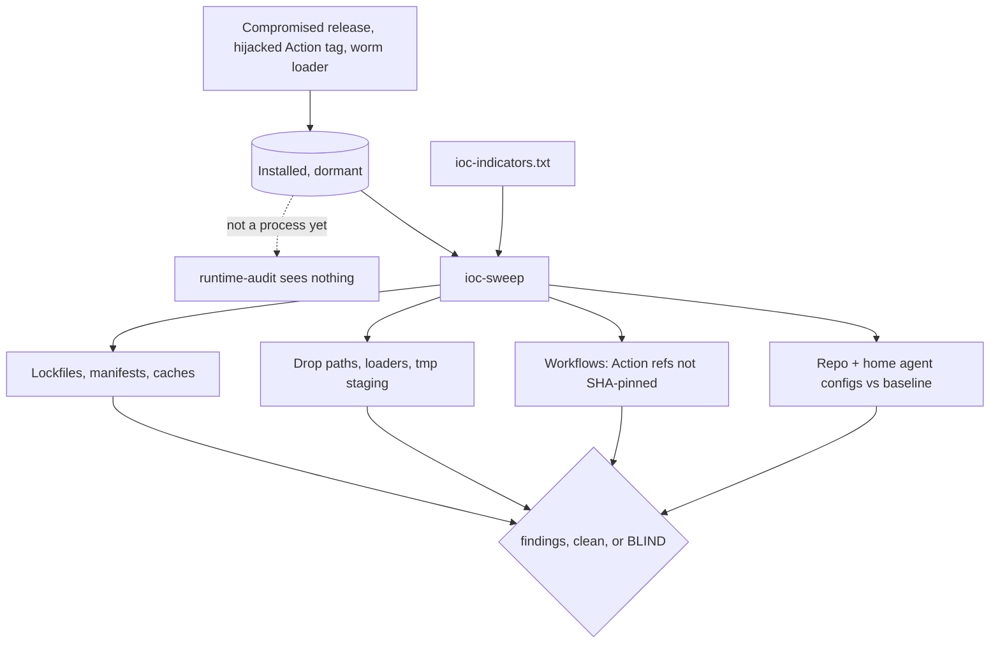

# Technical blueprints

These diagrams describe control flow and authority. They are kept in Mermaid so labels remain searchable and changes remain reviewable.

## Repository boundary

The publish arrow does not mean safe. It means the known-pattern gate and project tests passed.

## Scanner pipeline

Private markers remain outside the repository. The generic layer runs when no marker file exists and prints that limitation.

## Destructive-operation control stack

The shim and hook are bypassable brakes. Token, organization, and branch controls are server-side boundaries.

## Untrusted-content handling

Detection supports this flow but does not enforce it. The behavioral contract lives in [untrusted content](../references/untrusted-content.md).

## Research egress

The decision happens before retrieval, from the URL string alone. `BLOCK` has no override; `REVIEW` has one, and it must name the exact URL. Whatever comes back is still untrusted data.

## Host runtime

This is the one blueprint where the arrow that matters is the dotted one. A control on a path cannot see what never takes the path, so no amount of gate coverage substitutes for looking at the machine. `runtime-audit` looks at the machine — manually, at a single moment, at known command-line shapes. Schedule it, or it only ever confirms what you already suspected.

## On-disk indicators

The blueprint is a list and a walk. Everything it knows comes from the indicator file, so
it is only as current as the last line appended, and it says so by exiting `1` on a match,
`0` on none, and `2` when it could not look.
